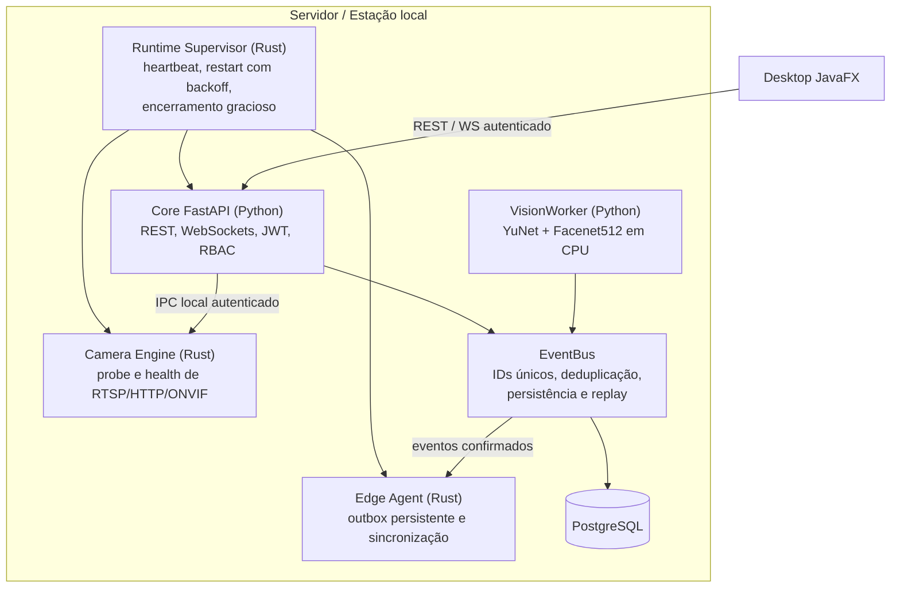
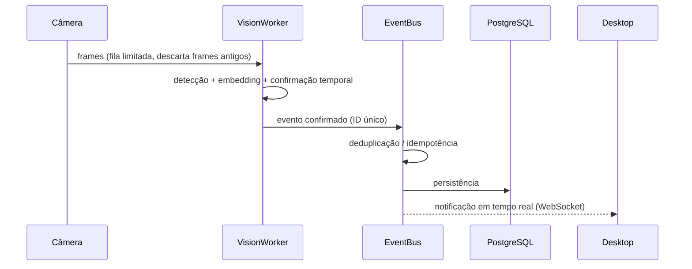
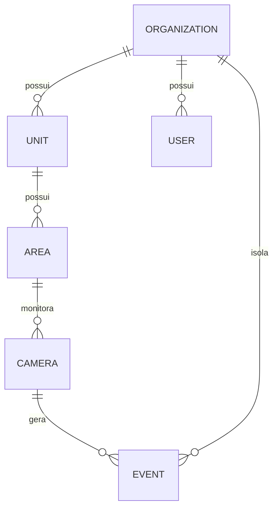

# Arquitetura — visão pública

Este documento descreve a arquitetura do I.See Enterprise em alto nível. Detalhes internos
(contratos privados, chaves, topologia de rede de clientes e código-fonte) não são publicados.

## Princípios

1. **Offline-first** — toda a operação essencial roda em uma máquina local ou servidor on-premises.
2. **Separação por responsabilidade de linguagem**
   - **Rust**: infraestrutura nativa de longa duração (supervisão de processos, conectividade de câmeras, outbox de borda).
   - **Python**: regras de negócio, API, visão computacional e IA.
   - **Java/JavaFX**: experiência desktop nativa para operadores.
3. **Núcleo único, verticais separadas** — School e Corporate reutilizam o mesmo backend.
4. **Segurança no servidor** — RBAC e isolamento multi-tenant são aplicados no backend, nunca apenas na interface.
5. **Degradação controlada** — falha de câmera, de visão ou de IA não derruba a operação essencial.

## Componentes

## Fluxo de um evento de reconhecimento

Frames de vídeo são **descartáveis** e nunca persistidos por padrão; apenas **eventos confirmados**
seguem a política de persistência e retenção configurada pela organização.

## Modelo multi-tenant

Perfis de acesso: **Admin**, **Director**, **Secretary** (e perfis operacionais), com permissões
verificadas no backend em cada rota.

## Supervisão e resiliência

- Reinício de processos com **backoff exponencial** e limite de tentativas.
- Encerramento gracioso antes de término forçado; sem processos órfãos.
- Timeouts de rede e limites de conexões simultâneas nos serviços nativos.
- Recuperação automática com proteção contra ciclos infinitos.
- Health checks (`/health`, `/health/ready`) usados pelo supervisor e pelo desktop.

## Distribuição

- **Windows**: instalador nativo (jpackage + WiX) com JRE embutido, runtime local e serviços nativos.
  A máquina final não precisa de Rust, Java SDK ou Python instalados.
- **Linux**: backend nativo com unidades systemd (em preparação).
- Docker é opcional — nunca obrigatório.
